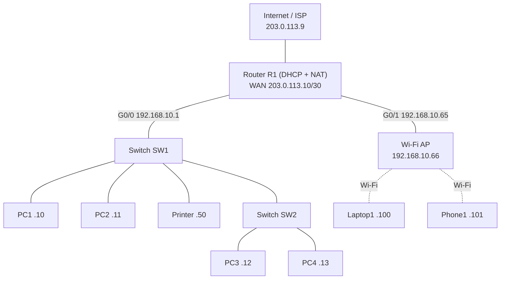

# Small Company LAN Design

Network checkpoint: MAC & frame handling, IP addressing & subnetting, routing & packet forwarding.

**Equipment:** 1 router (Internet access), 2 switches, 4 PCs, 1 printer, 1 Wi-Fi access point, 2 wireless devices.

## Topology



The router has 3 interfaces: G0/0 (wired LAN), G0/1 (wireless LAN) and G0/2 (WAN). The AP connects directly to the router, so wireless traffic has its own subnet.

---

## Part 1 – MAC & Frame Handling

### 1.1 MAC addresses

A MAC address is 48 bits (6 bytes) in hexadecimal: the first 3 bytes are the manufacturer ID (OUI), the last 3 identify the device. All devices use the example OUI `00:1A:2B`.

| Device | Interface | MAC address |
|---|---|---|
| Router R1 | G0/0 (wired LAN) | 00:1A:2B:00:00:01 |
| Router R1 | G0/1 (wireless LAN) | 00:1A:2B:00:00:02 |
| Router R1 | G0/2 (WAN) | 00:1A:2B:00:00:03 |
| Switch SW1 | Management | 00:1A:2B:00:00:11 |
| Switch SW2 | Management | 00:1A:2B:00:00:12 |
| PC1 / PC2 / PC3 / PC4 | NIC | 00:1A:2B:00:00:21 / :22 / :23 / :24 |
| Printer | NIC | 00:1A:2B:00:00:31 |
| Wi-Fi AP | Ethernet / radio | 00:1A:2B:00:00:41 |
| Laptop1 | Wi-Fi card | 00:1A:2B:00:00:51 |
| Phone1 | Wi-Fi card | 00:1A:2B:00:00:52 |

### 1.2 Frame from PC1 to the printer

PC1 (192.168.10.10) and the printer (192.168.10.50) are in the same subnet, so the frame is delivered at Layer 2 without the router.

1. PC1 sees the printer is in its own subnet.
2. PC1 checks its ARP cache; if needed, it broadcasts an ARP request ("Who has 192.168.10.50?") and the printer replies with `00:1A:2B:00:00:31`.
3. PC1 builds an Ethernet II frame and sends it to SW1.
4. SW1 learns PC1's MAC/port in its MAC address table and forwards the frame only on the printer's port.
5. The printer checks the FCS and passes the IP packet up the stack.

| Preamble | SFD | Destination MAC | Source MAC | EtherType | Payload | FCS |
|---|---|---|---|---|---|---|
| 7 B | 1 B | 6 B | 6 B | 2 B | 46–1500 B | 4 B |
| clock sync | start of frame | 00:1A:2B:00:00:31 (printer) | 00:1A:2B:00:00:21 (PC1) | 0x0800 (IPv4) | IP header (src .10, dst .50) + TCP 9100 + print data | CRC-32 error check |

### 1.3 Collision handling

**Wired Ethernet – CSMA/CD**
- Every device is on its own **full-duplex switch port**: each port is a separate collision domain and send/receive use separate wire pairs, so **no collisions occur**.
- On hubs or half-duplex links, **CSMA/CD** is used: listen before sending; if a collision is detected, send a **jam signal** and wait a random time (**binary exponential backoff**) before retrying.

**Wi-Fi – CSMA/CA**
- A radio can't send and listen at the same time, so Wi-Fi **avoids** collisions instead of detecting them.
- The device waits until the channel is free (DIFS), then waits an extra **random backoff** before sending.
- The receiver sends an **ACK**; no ACK means the frame was lost, so it retries with a longer backoff.
- **RTS/CTS** (optional) solves the *hidden node* problem (Laptop1 and Phone1 both hear the AP but not each other).

---

## Part 2 – IP Addressing & Subnetting

### 2.1 Subnets

Private range **192.168.10.0/24**, split into four **/26** subnets (mask 255.255.255.192). /26 borrows 2 bits → 2² = 4 subnets of 2⁶ = 64 addresses (62 usable hosts). Wired and wireless are separated for security and smaller broadcast domains.

| Subnet | Network | Usable hosts | Broadcast | Gateway |
|---|---|---|---|---|
| Wired LAN | 192.168.10.0/26 | .1 – .62 | 192.168.10.63 | 192.168.10.1 |
| Wireless LAN | 192.168.10.64/26 | .65 – .126 | 192.168.10.127 | 192.168.10.65 |
| Reserved | 192.168.10.128/26 | .129 – .190 | 192.168.10.191 | – |
| Reserved | 192.168.10.192/26 | .193 – .254 | 192.168.10.255 | – |

### 2.2 Address assignment

| Device | IP address | Mask | Default gateway | Method |
|---|---|---|---|---|
| Router R1 G0/0 | 192.168.10.1 | /26 | – | Static |
| Router R1 G0/1 | 192.168.10.65 | /26 | – | Static |
| Router R1 G0/2 (WAN) | 203.0.113.10 | /30 | 203.0.113.9 (ISP) | From ISP |
| SW1 / SW2 (management) | 192.168.10.2 / .3 | /26 | 192.168.10.1 | Static |
| PC1 – PC4 | 192.168.10.10 – .13 | /26 | 192.168.10.1 | DHCP |
| Printer | 192.168.10.50 | /26 | 192.168.10.1 | Static (reserved) |
| Wi-Fi AP | 192.168.10.66 | /26 | 192.168.10.65 | Static |
| Laptop1 | 192.168.10.100 | /26 | 192.168.10.65 | DHCP |
| Phone1 | 192.168.10.101 | /26 | 192.168.10.65 | DHCP |

*203.0.113.0/24 is a documentation range used as the example public address. DNS: 8.8.8.8.*

### 2.3 Role of DHCP

Router R1 is the DHCP server, so devices get their settings automatically:
- **WIRED pool:** 192.168.10.10 – .62, gateway .1 (excluded: .1 – .9 and .50).
- **WIRELESS pool:** 192.168.10.100 – .126, gateway .65 (excluded: .65 – .99).
- Each lease gives: **IP address, subnet mask, default gateway, DNS server, lease time**.

**DORA process:** **D**iscover (client broadcasts) → **O**ffer (router offers a free IP) → **R**equest (client asks for it) → **A**cknowledge (router confirms).

The printer, switches and AP use fixed addresses so other devices always find them at the same IP.

---

## Part 3 – Routing & Packet Forwarding

**Scenario:** Laptop1 (192.168.10.100) opens `https://www.example.com` (93.184.215.14, port 443).

```
Laptop1 --802.11--> Wi-Fi AP --802.3--> Router R1 (route + NAT) --> ISP router --> Internet routers --> Web server
src 192.168.10.100:50000              after NAT: src 203.0.113.10:62001 -> dst 93.184.215.14:443
```

### 3.1 Step by step

1. **DNS:** Laptop1 resolves www.example.com → 93.184.215.14.
2. **Local or remote?** The destination is not in 192.168.10.64/26, so the packet goes to the **default gateway 192.168.10.65**.
3. **ARP:** Laptop1 learns the router G0/1 MAC (`00:1A:2B:00:00:02`).
4. **Packet:** IP src 192.168.10.100, dst 93.184.215.14, TTL 64, protocol TCP; TCP ports 50000 → 443.
5. **Wireless hop:** sent in an **802.11 frame** using CSMA/CA (receiver = AP, transmitter = Laptop1, destination = router MAC).
6. **AP:** converts the frame to **802.3 Ethernet** (src Laptop1 MAC, dst router MAC). It works at Layer 2 and does not touch the IP header.
7. **Router R1:** removes the frame, reads the IP header, picks the route, applies NAT and sends a new frame to the ISP (src MAC `00:1A:2B:00:00:03`).
8. **Internet:** every router repeats: read destination IP → find route → TTL − 1 → new frame.
9. **Reply:** the server answers to 203.0.113.10:62001; R1 uses its NAT table to send it back to 192.168.10.100:50000 via G0/1 → AP → Laptop1.

### 3.2 How routers use the IP header

| Field | Use |
|---|---|
| Destination IP | Looked up in the routing table to choose interface and next hop |
| Source IP | Rewritten by NAT at R1; used by the server to reply |
| TTL | Decreased by 1 per router; at 0 the packet is dropped (ICMP Time Exceeded), which prevents loops |
| Header checksum | Checked, then recalculated because TTL/addresses changed |
| Protocol | TCP (6); tells NAT to translate ports |

MAC addresses change at every hop; IP addresses stay the same end to end (except where NAT rewrites them).

### 3.3 Choosing the next hop

R1 uses the **longest prefix match** in its routing table:

| Destination | Type | Next hop | Interface |
|---|---|---|---|
| 192.168.10.0/26 | Connected | – | G0/0 |
| 192.168.10.64/26 | Connected | – | G0/1 |
| 203.0.113.8/30 | Connected | – | G0/2 |
| 0.0.0.0/0 (default) | Static | 203.0.113.9 (ISP) | G0/2 |

93.184.215.14 matches only the **default route**, so the next hop is the ISP router 203.0.113.9 (MAC found with ARP), out of G0/2.

### 3.4 Role of NAT

Private addresses can't be used on the Internet. R1 uses **NAT overload (PAT)**: all devices share the public IP 203.0.113.10, and each connection gets its own port.

| Inside local | Inside global | Outside |
|---|---|---|
| 192.168.10.100:50000 (Laptop1) | 203.0.113.10:62001 | 93.184.215.14:443 |
| 192.168.10.101:51515 (Phone1) | 203.0.113.10:62002 | 142.250.1.1:443 |
| 192.168.10.10:49200 (PC1) | 203.0.113.10:62003 | 93.184.215.14:443 |

- **Outgoing:** private IP:port → public IP:free port, saved in the NAT table.
- **Incoming:** the table is used to restore the private IP:port.
- **Benefits:** saves public IPv4 addresses and hides the internal network.

---

## Conclusion

Wired and wireless devices are in two separate /26 subnets, DHCP configures them automatically, and one router connects the floor to the Internet using a default route and NAT. Layer 2 (MAC, switches, CSMA/CD, CSMA/CA) delivers frames inside each subnet; Layer 3 (IP, routing table, TTL, NAT) moves packets between subnets and to the Internet.
